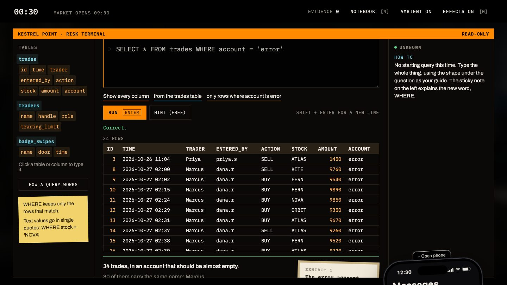
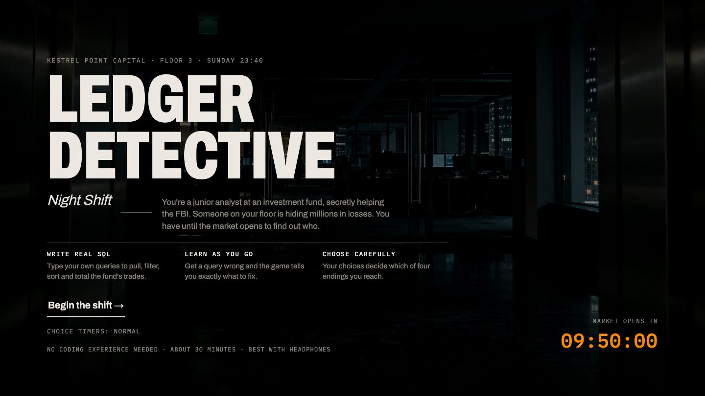
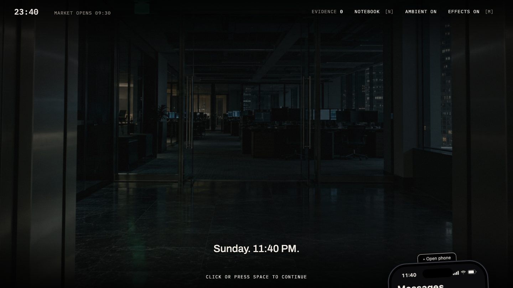
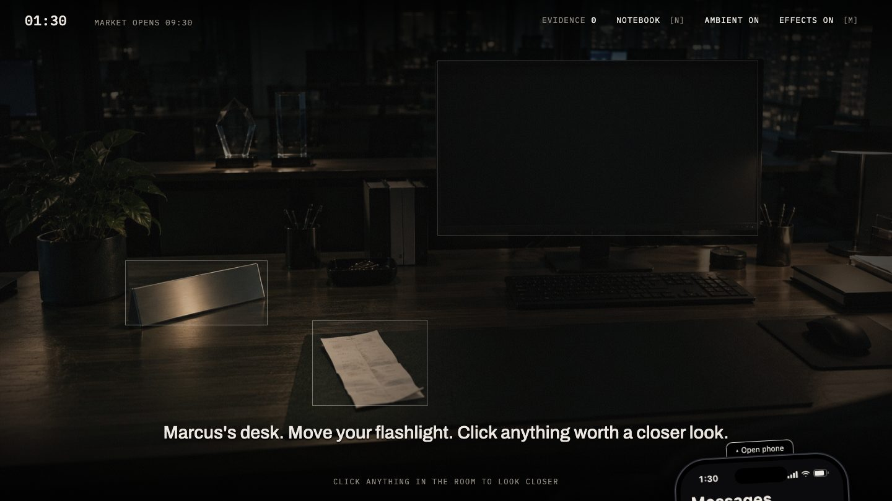
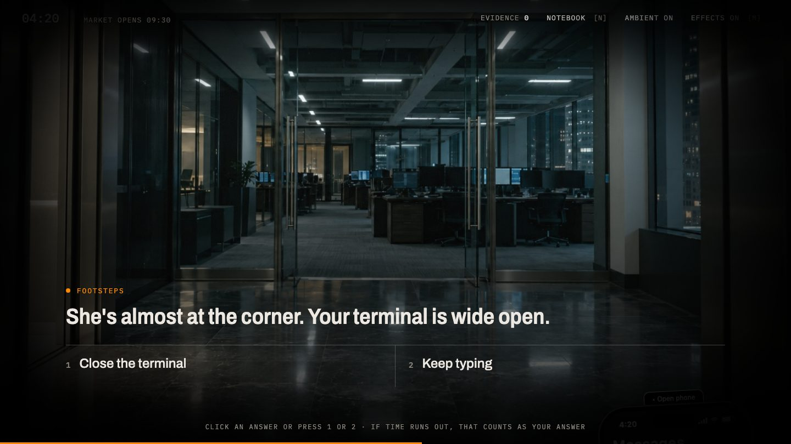

# Ledger Detective: Night Shift

An interactive thriller where you learn SQL by writing it yourself.

**[Play it in your browser →](https://kaylatgg.github.io/ledger-detective/)**



It's Sunday, 11:40 PM, on Floor 3 of Kestrel Point Capital, a fund that looks after two billion dollars. You're a junior risk analyst three weeks into the job, and secretly you're helping the FBI. Someone on your floor is hiding millions in losses. You have until the market opens at 9:30 AM to find out who, and the only tool you have is the fund's trade database.

About 30 minutes. Best with headphones. Plays in any modern browser on a laptop or desktop, with no install and no account.

## Contents

- [Screenshots](#screenshots)
- [How to play](#how-to-play)
- [What you'll learn](#what-youll-learn)
- [Features](#features)
- [Accessibility](#accessibility)
- [How it's built](#how-its-built)
- [Run it locally](#run-it-locally)
- [Credits](#credits)

## Screenshots

| | |
| --- | --- |
|  |  |
| **The title screen.** The countdown is real: it's how long you have until the bell. | **The first scene.** The story plays out in subtitles over each location. |
|  |  |
| **Searching a desk.** Click what looks worth a closer look to find clues. | **A timed choice.** The orange line at the bottom is the time you have left. |

## How to play

| Action | How |
| --- | --- |
| Move the story forward | Click, or press **Space** |
| Run a query | Type it in the terminal and press **Enter** (**Shift + Enter** adds a new line) |
| Get help | Press **Hint**. The first hint is free; each one after that costs 5 minutes on the clock. If you're still stuck, the last step shows the whole query for you to type. |
| Make a timed choice | Click an answer, or press **1**, **2** or **3**. If time runs out, that counts as your answer. |
| Search a room | Click anything that looks worth a closer look |
| Read your texts | Click **Open phone** at the bottom of the screen |
| Open the case notebook | Press **N**: who's who, clues, pinned evidence, terms and an SQL cheat sheet |
| Sound | Press **M** to turn all sound on or off, or use the **Ambient** and **Effects** buttons separately |

You type every query yourself. Pasting is turned off, because typing is how it sticks. Click a table or column name to type it into the query for you.

Your progress saves automatically in your browser, so you can close the tab and continue later.

## What you'll learn

No coding experience needed. A short interactive lesson shows how a query works, and every query you type is translated into plain English as you write it. The first few scenes walk you through where to type and what to do, then step back as you get the hang of it.

| Skill | What it does |
| --- | --- |
| `SELECT … FROM` | Choose which columns to show, from which table |
| `WHERE` | Keep only the rows that match |
| `AND` | Match two conditions at once |
| `ORDER BY … DESC`, `LIMIT` | Sort the results and keep the top few |
| `SUM`, `GROUP BY` | Add up totals for each person or group |
| `HAVING` | Filter those totals (optional bonus scene) |

When a query is wrong, the game explains the specific mistake in plain words, such as a missing comma, missing quotes or the wrong order, instead of just saying "error". You answer the same skills check at the start and the end of the night, so you can see how far you came.

The full learning goals sheet, covering who the game is for, what they'll learn and which scene teaches each skill, is in [LEARNING-GOALS.md](LEARNING-GOALS.md).

## Features

- **Four endings**, decided by what you find and the choices you make
- **A case notebook** that fills in as each person enters the story
- **Evidence you pin yourself**, in your own words, then send to the FBI in a final report
- **A clock you can hear**: it rolls forward as the night goes on, chimes on the hour, and costs you minutes for extra hints and risky choices
- **A score that builds through the night**, generated live in the browser
- **An end screen that shows what you learned**: your before and after answers, every skill you used, and the mistakes you fixed

## Accessibility

- **Choice timers setting:** Normal, Double time or Off. Change it on the title screen or in the case notebook.
- **Keyboard:** everything can be played without a mouse, with a visible focus ring on every control.
- **Screen readers:** subtitles, texts, terminal messages and query results are announced as they appear.
- **Reduced motion:** with your system's "reduce motion" setting on, the game skips its animations.
- **Readable text:** nothing smaller than 12px, and contrast checked to WCAG AA, including subtitles over every scene image.

Checked with [axe-core](https://github.com/dequelabs/axe-core) against the WCAG 2.2 A and AA rules, plus checks for keyboard access, zoom to 200%, text size and timers.

## How it's built

Plain HTML, CSS and JavaScript, with no framework and no build step.

- **The database runs in your browser.** [sql.js](https://github.com/sql-js/sql.js) is SQLite compiled to WebAssembly, so the queries you type are real SQL against a real database, and nothing you type is sent anywhere.
- **The case is generated.** `data/build_case.py` builds the fund's trade, trader and badge-swipe tables with every clue planted on purpose, and `data/check_case.py` runs each scene's query to confirm the clue is really there.
- **The feedback is written for beginners.** `js/checker.js` compares your result with the expected one and names the likely mistake, and `js/translate.js` reads your query back in plain English as you type.
- **Every sound is synthesized** with the Web Audio API. There are no audio files.

```
index.html          the page and every screen
css/style.css       all styling
js/story.js         the whole story, beat by beat (edit text here)
js/game.js          plays the story, keeps score, saves progress
js/ui.js            scenes, subtitles, phone, choices, notebook
js/terminal.js      the SQL terminal, hints and evidence pinning
js/checker.js       checks queries and explains mistakes
js/translate.js     plain-English reading of a query
js/lesson.js        the "How a query works" lesson
js/db.js            loads sql.js and the case database
js/sound.js         all sound, generated in code
js/case-data.js     the case database (generated, don't edit)
data/               scripts that build and check the case database
lib/                a local copy of sql.js
images/             scene images, generated with ChatGPT
docs/screenshots/   the screenshots in this README
```

## Run it locally

Clone the repository, then serve the folder:

```
git clone https://github.com/kaylatgg/ledger-detective.git
cd ledger-detective
python3 -m http.server
```

Open http://localhost:8000. Served this way, the SQL engine loads from `lib/`, so the game itself runs offline (the fonts still load from Google Fonts). Opening `index.html` directly also works, but then the SQL engine loads from a CDN and needs an internet connection.

For development:

- Add `?dev` to the URL to jump to any beat and see the click coordinates for room hotspots.
- After changing `data/build_case.py`, run `python3 data/build_case.py` to rebuild `data/case.sql` and `js/case-data.js`, then `python3 data/check_case.py` to confirm every clue still holds.
- Before publishing an update, bump `RELEASE` in `index.html` so returning players get the new files instead of cached ones.

## Credits

Made by Kayla Tang for CTEC 200: Innovation and Coding, Ringling College of Art and Design, Fall 2026.

The scene images were generated with ChatGPT (OpenAI) from prompts written by the author. Fonts, libraries and other attributions are listed in [CREDITS.md](CREDITS.md). All characters, companies and trades are fictional.
